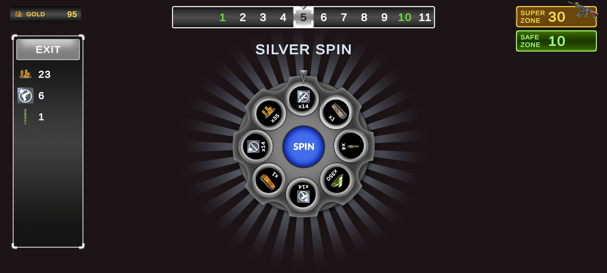
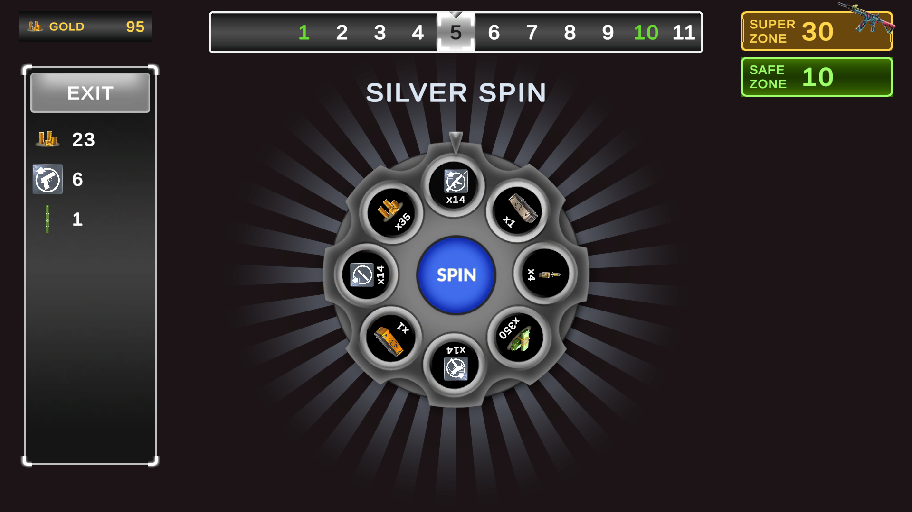
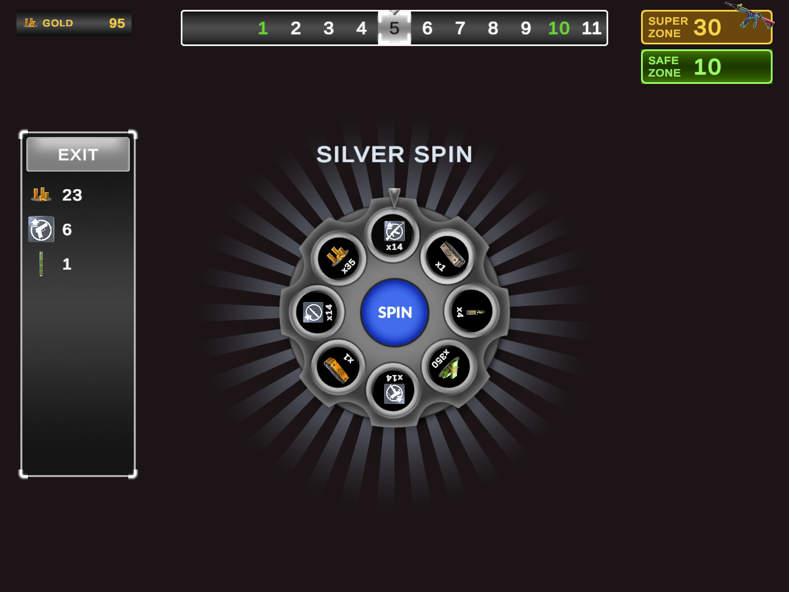

# Wheel of Fortune — Vertigo Games Case

A wheel-of-fortune take on the Critical Strike "Card Game" mode, built in **Unity 6000.3.23f1** for **Android**.

**APK:** see [Releases](../../releases). **Video:** link in the release notes. To reach the super zone quickly, the video was recorded with the super interval temporarily set to 15 in `ZoneProgressionSO`; the APK and the repo use 30.

| 20:9 | 16:9 | 4:3 |
|---|---|---|
|  |  |  |

## How to play

- Tap **SPIN**. The wheel stops on a reward or on the bomb.
- Rewards are collected in the left panel and **get bigger every zone**.
- **Bomb** — all collected rewards are lost. Give up (start over) or **revive** with gold from the wallet.
- **Every 5th zone is a safe zone** (silver wheel, no bomb).
- **Every 30th zone is a super zone** (golden wheel, no bomb). Reaching it awards a special weapon, shown in advance in the top-right box.
- You can **leave and keep your rewards only on safe/super zones**, between spins. Collected gold goes to the wallet (top left).

## Architecture

```
ScriptableObjects (data)  ──►  GameBootstrapper (composition root)  ──►  GameSession (rules, pure C#)
                                                                            │ events
                                                                            ▼
                                                              Views (MonoBehaviour + DOTween)
                                                              call session methods on input
```

- **Logic and view are separated.** All game rules live in plain C# classes in the `VertigoCase.Gameplay` assembly. It has no Unity references, so it is covered by EditMode tests.
- **The result is decided before the animation.** `WheelSpinResolver` picks a weighted slice through `IRandomProvider`; `WheelView` only rotates to that slice. Tests use a scripted random provider.
- **State machine.** `GameSession` has five states: `ReadyToSpin → Spinning → (BombHit | SuperRewardOffer) …`, plus `CashedOut`. Views listen to C# events (`StateChanged`, `ZoneChanged`, `SpinStarted`, …) and call methods back (`Spin`, `Exit`, `Revive`, …).
- **No singletons.** `GameBootstrapper` turns the ScriptableObjects into plain rule objects, builds the session and hands it to each view through `Init(...)`.
- **Everything is editable from the editor:**

  | Asset | What it holds |
  |---|---|
  | `RewardDefinitionSO` | id, name, icon, is-bomb |
  | `WheelConfigSO` | title, sprites, 8 slices (reward, base amount, weight) |
  | `ZoneProgressionSO` | safe/super intervals, reward growth per zone, wheel per zone type, special reward pool, revive cost, starting gold |

- **Fail fast on bad data.** The game checks the data at startup and stops with a clear message if something is wrong, for example a bomb on a safe wheel, a wheel without exactly 8 slices, a reward with amount 0, all weights 0, or safe/super intervals that never produce a safe zone.

### Folders

```
Assets/_Project/
  Data/            ScriptableObject assets (rewards, wheels, progression)
  Prefabs/UI/      wheel slice, reward row, zone bar item
  Scenes/Game.unity
  Scripts/Core/    GameBootstrapper
  Scripts/Data/    ScriptableObject definitions
  Scripts/Gameplay/ rules (pure C#)
  Scripts/UI/      views
  Tests/EditMode/  NUnit tests for the rules
```

### UI rules followed

- Changing elements end in `_value`, and names go from general to specific (`ui_text_zone_value`, `ui_button_exit`).
- References are filled by `OnValidate`. Listeners are added in `OnEnable` and removed in `OnDisable`; there are no Inspector `OnClick` bindings.
- Animated transforms are children of their root (`ui_wheel > ui_wheel_rotator`). Raycast Target and Maskable are off on decorative images. Frames and panels use sliced sprites. Icons use Preserve Aspect.
- Canvas Scaler uses Scale With Screen Size (1920×1080) with **Expand**, so the layout fits 20:9, 16:9 and 4:3.

## Tests

The rules have EditMode tests: zones, weighted spin, reward scaling, reward collection, wallet, special rewards and the full session flow. They run in the Unity Test Runner, or without Unity:

```
bash Tools/TestRunner/run-tests.sh
```

## Design decisions

- **Exit only on safe/super zones.** The document states this rule explicitly, so it was followed even though the original card game allows leaving at any time.
- **"Rewards get better every zone"** is implemented as `amount = base × (1 + (zone − 1) × growth)`, with growth 10% set in `ZoneProgressionSO`. The silver and golden wheels also carry better rewards. Slice contents are fixed per wheel type. Making contents improve over zones could be added by giving each zone type a list of `WheelConfigSO`s, one per zone range; the session already reads its wheels from data.
- **Revive costs gold from a wallet.** The wallet is kept separate from the run rewards: a bomb clears the run but not the wallet. **Starting gold is 100**, so reviewers can try revive and reach zone 30 without grinding. Change it in `ZoneProgressionSO`. The wallet is not saved between app launches; persistence was out of scope.
- **Super zone special reward.** It is picked at random from a pool at the start of each 30-zone cycle and shown in advance in the top-right box. Reaching the zone opens a claim popup, then the golden wheel is spun.
- **Unused provided assets.** Three reward icons are byte-identical duplicates of used ones (`Pistol_Points_`, `Submachine_Points`, `Vest_Points`). Five more reward icons have no free slot, because each wheel has 8 slices and all of them are already in use. `ui_card_panel_zone_current` (blue) is the alternative color of `_current_white`; the white one matches the zone bar's color scheme.
